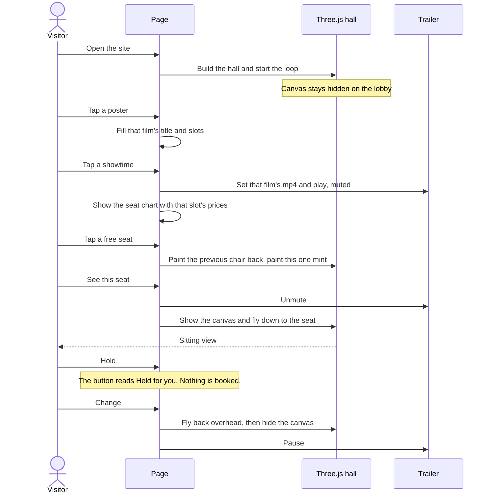
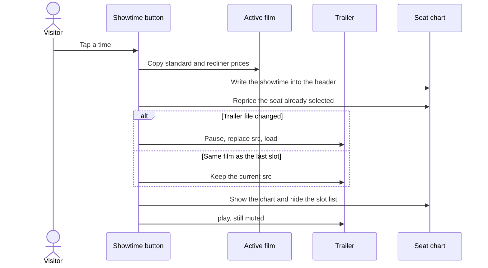
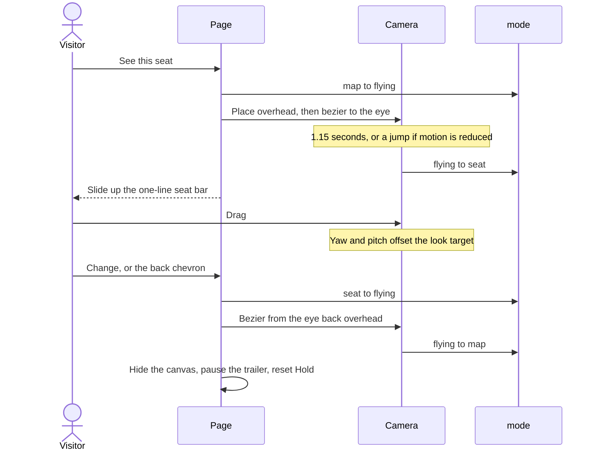
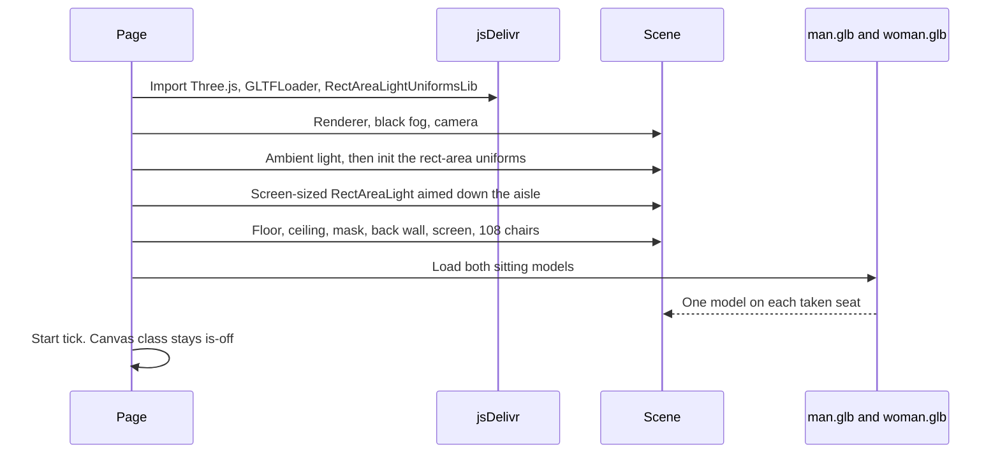

# Hong Kong Cinema

A mock cinema app for picking a seat in Hall 3 and seeing the screen from that seat. It is not a real cinema, and it does not take payment.

Live preview: [mock-hong-kong-cinema.nullmicgo.com](https://mock-hong-kong-cinema.nullmicgo.com/)

Developed by [Michael Lau](http://nullmicgo.com/).

## Demo

A walk through the lobby, a showtime, a seat, and the view from that seat. The recording has sound. Unmute the player if you want the trailer.

https://github.com/user-attachments/assets/76103fa6-e00a-4413-a121-175cbea6be64

## Screen flow

The page is four full-screen layers in one document. Only one task layer is interactive at a time. The WebGL canvas stays hidden until the visitor asks to see the seat.

```text
Lobby  →  Showtimes  →  Seat chart  →  Seat view
#lobby     #times         #map          #stage + #pov-chrome
```

1. **Lobby.** Date chips and two poster cards. The chips only move the underline. Both films stay listed on every date. The footer states that this is a mock.
2. **Showtimes.** Tapping a poster fills the title, rating line, and that film's slots. Each slot shows a time, the standard price, and `HOUSE 3`. Back returns to the lobby.
3. **Seat chart.** Tapping a slot writes that slot's standard and recliner prices, swaps the trailer if the film changed, and shows Hall 3. Row A is nearest the screen. Rows H and I are recliners. Taken seats cannot be selected. The footer shows the chosen seat and its price.
4. **Seat view.** **See this seat** unmutes the trailer and flies the camera from above the chair down to sitting height. A one-line bar names the seat. **Hold** only changes the button to "Held for you" in this browser. **Change**, or the back chevron, flies back to the chart and pauses the video. **Showtimes** returns to the slot list.

Dragging on the seat view looks a little left, right, up, and down. The look returns to the seat's aim when you leave.

## Sequence

Four participants carry the visit. The page is the DOM. The hall is the Three.js scene, already running behind a hidden canvas. The video element is the trailer. Nothing here calls a server.

### From the lobby to a held seat



### Choosing a showtime



Date chips are not in this sequence. Tapping one only moves the underline. Both films stay on the lobby for every date.

### Seeing the seat, then leaving it



Hold does not leave the seat. It only disables the button and changes its label.

### What the page builds before the first tap



## Technical solution

The app is one page. DOM layers handle choosing a film and a seat. Three.js draws the hall behind them and is revealed only for the fly-in. There is no scene file, no backend, and no build. An import map loads Three.js 0.170 and two addons from a CDN:

```html
<script type="importmap">
{
  "imports": {
    "three": "https://cdn.jsdelivr.net/npm/three@0.170.0/build/three.module.js",
    "three/addons/": "https://cdn.jsdelivr.net/npm/three@0.170.0/examples/jsm/"
  }
}
</script>
```

The module imports `THREE`, `GLTFLoader`, and `RectAreaLightUniformsLib`. `RectAreaLightUniformsLib.init()` has to run before the screen light is created, or that light does not shade anything.

### Films and prices

`films` holds the two titles. A showtime button stores `standard` and `recliner` on the button. Choosing the slot copies those numbers onto the active film and points the `<video>` element at that film's mp4. Recliner seats (`row` H or I) use the recliner price. Every other seat uses the standard price.

The sample prices, in HKD:

| Film | Show | Standard | Recliner |
| --- | --- | --- | --- |
| 《鎗火》 | 05:30 PM · 2D | 120 | 170 |
| 《鎗火》 | 07:45 PM · IMAX | 180 | 230 |
| 《鎗火》 | 10:15 PM · 3D | 145 | 195 |
| 《柔道龍虎榜》 | 02:30, 05:15, 08:00 PM · 2D | 120 | 170 |

### Seat chart

Nine rows, A through I, twelve seats each, with an aisle between seats 6 and 7. The same list builds both the buttons and the 3D chairs.

A seat is taken when it is not a recliner and `(rowIndex * 5 + seatNumber * 3) % 7 === 0`. That is a fixed pattern, not a booking system. The chart scales each row slightly so the back rows read as farther from the screen.

Selecting a seat paints that chair mint in the 3D scene and writes the row, number, and price into the footer. The default seat is B4.

### Three.js scene

One `WebGLRenderer` draws into the `#stage` canvas. The canvas is in the page from the start, but the class `is-off` sets `visibility: hidden` until **See this seat**. The scene is already built and the animation loop is already running. Hiding the canvas is what stops the hall from flashing through the lobby.

Renderer settings:

- Output color space `SRGBColorSpace`, so the video and the seat colors match the screen.
- `ACESFilmicToneMapping` at exposure `1.08`, so the screen light rolls off instead of clipping the seat tops white.
- Pixel ratio capped at 2.
- Fog from 30 to 52 units, black, so the back of the room falls away.

The scene graph is small. A black floor, ceiling, a mask plane behind the screen, and a back wall. In front of those sit the screen bezel, the screen plane, and 108 chair groups. Units are metres. The screen is at `z = 0`. Positive `z` walks back through the audience. Positive `y` is up.

Each seat is placed from its row index `r` (A is 0) and number `n`:

```text
x = left of the aisle for seats 1–6, right of the aisle for seats 7–12
    aisle gap 1.85, seat pitch 0.84
z = 7.4 + r * 1.46
y = 0.15 + r * 0.22
```

Row A is the closest row. Each row behind it is 1.46 m farther from the screen and 0.22 m higher, which is the floor rake. The 2D chart uses the same list, and scales each row by `0.82 + r * 0.028` so the back rows look farther away.

### A chair

One back, cushion, headrest, and armrest geometry is built once and shared by every chair. The back is a rounded rectangle `ExtrudeGeometry` (0.70 wide, 0.78 tall, 0.16 deep) with a small bevel. The cushion is a box, the headrest is a cylinder on its side, and the arms are dark boxes on posts.

The chair's local `+z` is the back, away from the screen, so a person sitting in it faces `-z`. Seat cloth is one shared `MeshPhysicalMaterial` per state: red for a free standard seat, rose for a recliner, dim red for a taken seat, mint for the selected seat. The material uses roughness `0.8` and sheen `0.35`, which reads as theatre fabric under the screen light. Arms stay a separate dark `MeshStandardMaterial` and do not change color. Selecting a seat does not clone geometry. `paintSeat` points the back, cushion, and headrest at the mint material, and points the previous chair back at its own material.

### Screen, video, and light

The cinema screen is a 22 by 10 plane, about 2.2:1, centred at `y = 6.15`. Its material is `MeshBasicMaterial`, so the picture is not affected by lights. The picture is a `VideoTexture` on a `<video>` element that is in the DOM at 1 by 1 pixel and fully transparent. The element has to exist and be allowed to play. Three.js copies the current video frame into the texture while the renderer draws.

Trailers are 16:9. The screen is wider, so the texture is cropped instead of letterboxed:

```text
repeat.y  = (16 / 9) / (22 / 10)   ≈ 0.808
offset.y  = (1 - repeat.y) / 2
```

That keeps the middle of the frame and cuts the top and bottom. Playback starts when a showtime is tapped, which is a user gesture, so the browser allows it. The video stays muted until **See this seat**. It loops, and it pauses when the visitor leaves the seat view. Switching films replaces `video.src` only when the URL changed, then calls `load()` and `play()`.

The seats are not lit from behind the audience. A `RectAreaLight` the same size as the screen sits just in front of it, at `(0, 6.15, 0.55)`, and `lookAt(0, 1.6, 18)` aims it down the aisle. A rect area light emits along its local `-z`, and `lookAt` points that axis at the target, so the light travels from the screen toward the seats. An `AmbientLight` at intensity `0.2` keeps the unlit side from going pure black. Seat tops and faces toward the screen catch the picture light. The backs of the chairs stay dark.

### Camera and the fly-in

The camera is a `PerspectiveCamera` with near `0.08` and far `100`. A `ResizeObserver` sets the aspect from the canvas. When the canvas is taller than it is wide, the vertical field of view opens from 52 degrees to 64 degrees. A phone is tall, and 52 degrees aimed at the screen cuts off the seat backs in the next row. The wider phone field of view keeps that row above the bottom bar.

For a chosen seat the eye and the look target are:

```text
eye    = (seat.x,  seat.y + 1.05, seat.z - 0.02)
target = (seat.x * 0.42, eye.y + 0.55, 0)
```

The eye is sitting height, just in front of that chair's back. Multiplying `x` by `0.42` turns a side seat toward the middle of the screen instead of staring at the side wall. Adding `0.55` to the eye height looks slightly upward, which leaves the row in front in the lower part of the frame.

The flight is one quadratic bezier for position and a second one for the look point. It starts overhead at about 7.6 m above the seat, passes a control point 4.6 m up, and ends at the eye. Each frame does:

```text
t = min(1, t + dt / 1.15)
e = 1 - (1 - t)³
position = quad(overhead, control, eye, e)
look     = quad(overheadLook, controlLook, target, e)
camera.lookAt(look)
```

The cubic ease-out spends more time settling into the chair than leaving the overhead view. `prefers-reduced-motion` copies the end pose and skips the curve. The mode goes `map` → `flying` → `seat`. The bottom bar is closed during the flight and opens when `t` reaches 1. Leaving the seat runs the same curve backwards, hides the canvas again, and pauses the video.

While `mode` is `seat`, a drag does not move the camera. It offsets the look target: yaw adds to `x`, pitch subtracts from `y`, both clamped. Releasing the pointer keeps the last offset until the visitor leaves the seat, which resets both to 0.

### People in taken seats

`GLTFLoader` loads `man.glb` and `woman.glb` once. They are baked sitting poses from Mixamo, not skinned at runtime. The exported vertices are in centimetres and the body stands along local `-z` (the head is near `z = -133`, the feet near `z = 0`). Putting that mesh in the hall takes two rotations, and they cannot be the same object's Euler angles. Three.js applies an XYZ Euler in an order that lays the mesh through the floor if both turns are on one object.

The fix is a child and a parent:

```text
child.rotation.x = π / 2      stand the -z body up onto +y
child.scale      = 0.01       centimetres to metres
parent.rotation.y = π + yaw   turn the face from the camera toward the screen
parent.position  = (0, 0.06, 0.02)
```

The parent is added to the chair group, so the person moves with that seat. `(rowIndex + seatNumber) % 2 === 0` uses the woman. The other taken seats use the man. A small yaw, a few degrees, keeps the row from looking cloned. Hair and glasses come in with blended transparency. Those materials are switched to `alphaTest = 0.45`, `transparent = false`, and `depthWrite = true`, and every mesh is `frustumCulled = false`. Without that, the hair sorts in front of the screen or disappears when the scaled bounds fall outside the frustum.

## Run it locally

```bash
python3 -m http.server 8771
```

Then open [http://127.0.0.1:8771/](http://127.0.0.1:8771/).

Opening `index.html` as a file fails. ES modules and the model loader need an HTTP origin.

## What is in this repo

| File | Role |
| --- | --- |
| `index.html` | Lobby, showtimes, seat chart, and the 3D hall |
| `poster001.jpeg` | Poster for 《鎗火》 |
| `Throw-Down-poster.jpg` | Poster for 《柔道龍虎榜》 |
| `man.glb`, `woman.glb` | Seated audience on taken seats |
| The two trailer `.mp4` files | Played on the cinema screen |
| `demo.mp4` | Walkthrough in this README |

Posters and trailers are used here as a personal mock. They belong to their rights holders.

## Credits

- [Website](http://nullmicgo.com/)
- [LinkedIn](https://www.linkedin.com/in/nullmicgo/)
- [YouTube](https://www.youtube.com/@nullmicgo)
